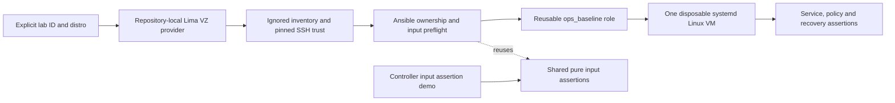

# Linux fleet automation

Ansible baseline automation for explicitly owned disposable Linux virtual
machines. The project separates safe controller policy tests from real guest
provisioning, idempotence, security inspection, service reachability, rollback
and reboot exercises. It is lab/reference engineering work, not a production
hardening certification or employment claim.

Implementation is in progress. Role and provider source exist; the required
Ansible and real-VM gates are not yet credited as passed. Publication, CI and a
versioned release are pending. The [validation report](docs/validation.md) is the
authoritative result ledger, and [core acceptance](docs/acceptance.md) defines
what must actually run before completion.

## Architecture



The provider owns only this checkout's `.runtime/lima` resources. It downloads
hash-pinned official images, generates a guest host key before boot, and seeds
strict SSH trust locally and in the guest. No host directories are mounted and no
SSH agent is forwarded. The role checks the fixed inventory group, explicit
ownership variables and a root-owned guest marker before configuration changes.
See [architecture](docs/architecture.md) and [ADR 0001](docs/adr/0001.md).

| Capability | Ubuntu 24.04 ARM64 target | AlmaLinux 9 ARM64 target |
| --- | --- | --- |
| Package manager | `apt` | `dnf` |
| Management/time services | `ssh`, `chrony` | `sshd`, `chronyd` |
| Native firewall | Owned `inet ops_fleet` nftables table and dedicated unit | `firewalld` public-zone SSH/HTTP rules |
| Kernel security boundary | Require AppArmor enabled | Require SELinux enforcing; retain file labels |
| Web workers | `www-data` | `nginx` |

These are implementation targets, not yet passed distro integration claims.
The role also creates a locked `ops-observer` account/group, a precisely scoped
sudo rule, validated SSH policy, bounded journald retention, chrony configuration,
and nginx with non-root workers and systemd restrictions. Guest HTTP uses port 80;
nonstandard ports are rejected so the lab does not bypass SELinux port policy.

## Prerequisites and controller quickstart

Use patched Python **3.14.7** for the exercised controller profile, Git, Make,
Bash, and outbound HTTPS for the first bootstrap. Exact Python/controller,
collection, provider and image pins are recorded in the lockfiles and dependency
provenance under `docs/`. No global package installation is required. Bootstrap
installs developer tools under `.venv`, `.tools` and `.ansible/collections`.

From this repository's checkout, with `python3.14` resolving to the intended
interpreter (or replace it with its absolute path):

```sh
make help
make PYTHON=python3.14 bootstrap
make doctor
make validate
make demo
```

Later targets use the local virtual environment. `make validate` includes Ruff,
ShellCheck, shfmt, actionlint, production-profile ansible-lint, structural checks,
provider safety tests and actual Ansible input-policy tests. Missing required
tools fail; they are not silently skipped. Bootstrap downloads tools but creates
no VM. `make doctor` inspects prerequisites and versions, not guest health.

`make demo` executes the real role's pure input assertions on localhost with
`become: false`: accepted configuration passes with no changes, and an invalid
port fails before any target mutation. The wrapper requires that failure and then
returns success. This is a controller policy demonstration, not a provisioning,
Linux, systemd or idempotence result. Ansible may create temporary controller
files; it does not change host configuration.

```sh
.venv/bin/ansible-playbook -i localhost, playbooks/check-input.yml \
  --extra-vars @tests/fixtures/valid-input.json
.venv/bin/ansible-playbook -i localhost, playbooks/check-input.yml \
  --extra-vars @tests/fixtures/invalid-port.json
```

The second command intentionally exits nonzero. Further fixtures reject incorrect
types, unsafe content, an unsuitable account name and invalid journal retention.
The same `roles/ops_baseline/tasks/validate_inputs.yml` is used by real provisioning.

## Real VM profile

The implemented provider requires **macOS ARM64**, macOS 13 or newer, and Apple
Virtualization.framework through project-local Lima. Ubuntu 24.04 and AlmaLinux 9
cloud images are locked to explicit official builds and SHA-256 digests in
`provider.lock.json`. Intel Macs, Linux/KVM, Docker containers and other providers
are not claimed implementations here.

Each guest requests **2 CPUs, 2 GiB RAM and a 24 GiB sparse virtual disk**. Only
one lab VM runs at a time; stop the first before starting the second. Budget
additional host memory, disk for tool/image caches and virtual-disk growth.
Retaining two stopped guests retains both disks. These are configured resource
requirements, not measured performance or memory-use claims. Provisioning and
patching need internet access for the selected distributions' repositories; OS
package versions are not frozen repository snapshots.

The intended complete integration commands are:

```sh
make integration LAB=ubuntu
make integration LAB=alma
```

This profile must exercise the real VM lifecycle, initial converge, zero-change
second converge, assertions, invalid configuration, a content change/rollback and
an explicitly scoped reboot/patch profile. Consult the validation report for which
steps actually ran. It changes only the selected lab guest; it is not equivalent
to the safe controller demo. Heavy profiles must remain sequential.

For manual diagnosis, first inspect the provider dry run, then explicitly start
the intended guest and select its exact inventory:

```sh
.venv/bin/python scripts/lab.py start --distro ubuntu --lab-id ops-fleet-reference
.venv/bin/python scripts/lab.py start --distro ubuntu --lab-id ops-fleet-reference --execute
ANSIBLE_INVENTORY="$PWD/.runtime/inventory-ubuntu.json" \
  .venv/bin/ansible-playbook playbooks/site.yml
PATH="$PWD/.venv/bin:$PATH" \
OPS_FLEET_INVENTORY="$PWD/.runtime/inventory-ubuntu.json" \
ANSIBLE_HOME="$PWD/.runtime/ansible-home" \
XDG_CACHE_HOME="$PWD/.runtime/controller-cache" \
  .venv/bin/molecule test -s default
```

Molecule's native scenario runs syntax, converge, idempotence and verification
against the real external inventory. The provider manages creation/teardown
explicitly; no fake create/destroy driver is used. For AlmaLinux, substitute `alma`
and `inventory-alma.json`. Do not use a combined inventory containing stopped
instances. Guest HTTP is inspected inside the VM; port 80 is not forwarded to the
host or exposed as a public service. Only the provider's SSH transport uses a
localhost endpoint.

## Failure, rollback and maintenance

The [runbooks](docs/runbooks.md) show invalid-input rejection, an identifiable
content change and rollback, SSH/configuration troubleshooting, and scoped
maintenance. The site play specifies `serial: 1` and stops on failure. The core
tests one VM at a time; multi-host rolling availability is not demonstrated.
The optional patch play requires explicit `ops_baseline_patch_confirm` matching
the lab ID and a boolean `ops_baseline_patch_reboot: true`; it updates guest
packages and reboots with postchecks. Nothing schedules unattended maintenance.

Package/time/firewall/service behavior and the effect of nginx restrictions must
be verified on both real guests. A syntax pass does not prove them. The service
checks assert content, headers, denied POST, unprivileged workers and effective
policy. Firewall rule inspection is not proof of a denied external network path.
Chrony tracking output does not itself prove synchronization to a trusted source.

## Security and teardown

Do not run the role against real hosts or change the ownership guard to make a
failed check pass. Keep `.runtime` private: it contains keys, SSH trust, guest
inventory, image caches, state and operational logs. Public evidence must be
reviewed and redacted. The provider rejects unknown resource identities,
configuration/trust drift and unexpected runtime paths. See [security](SECURITY.md).

No cloud resources, billable services, registry publication, host firewall/SSH/sudo
changes or account-wide settings are authorized. Guest management access is
preserved: the role does not restrict `AllowUsers` or replace the provider account.
SELinux/AppArmor and firewall failures are blockers, not reasons to disable them.

Teardown is scoped and defaults to dry run:

```sh
make teardown LAB=ubuntu
.venv/bin/python scripts/lab.py destroy --distro ubuntu \
  --lab-id ops-fleet-reference --execute --confirm ops-fleet-reference
```

Use the same explicit command with `--distro alma` for the other owned guest.
The provider verifies inventory/resource ownership, stops a running target and
deletes only that VM and its recorded per-instance configuration/trust files.
Image caches and shared runtime metadata may remain. `make clean` reports retained
state and does not silently remove VMs or credentials. Never use a blanket prune,
recursive deletion or ordinary global Lima home as a cleanup shortcut.

## Limits and review walkthrough

Only the named image/provider combinations are targeted. Debian, Rocky Linux,
additional providers, external identity and production SSH PKI remain extensions.
The seeded host-key workflow is a disposable-lab trust bootstrap, not enterprise
key distribution. Nginx is local HTTP, not an authenticated/TLS production service.
AppArmor enablement does not imply a custom nginx confinement profile.

For a review or interview, trace an invalid value from `check-input.yml` into the
shared assertions, follow ownership preflight before package mutation, compare
Ubuntu and AlmaLinux variable files, and explain how the second converge differs
from a fixture test. Then use real evidence to demonstrate one reversible change
and its verification. Do not describe an unexecuted VM profile as successful.

Original work is [MIT licensed](LICENSE). See [contributing](CONTRIBUTING.md),
[continuation instructions](AGENTS.md), [validation](docs/validation.md) and the
[changelog](CHANGELOG.md).
