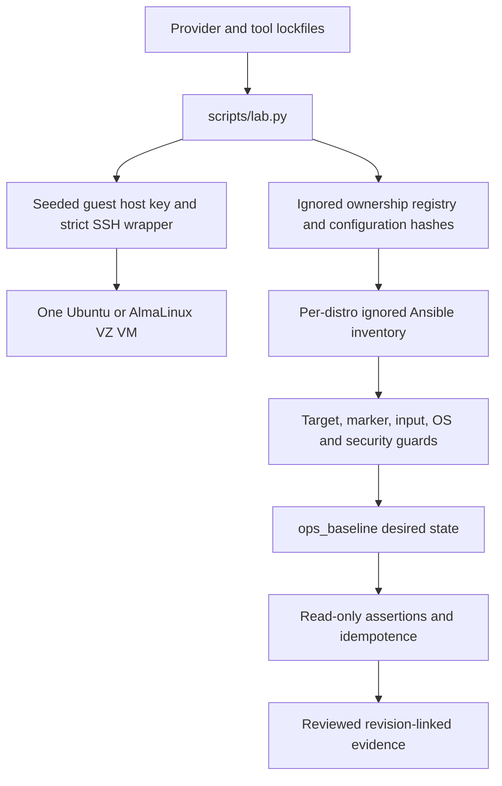

# Architecture and execution boundaries

The controller owns lifecycle and evidence; the Ansible role owns guest desired
state. These responsibilities meet at a small private inventory contract:
`fleet_lab`, one named instance, `ops_lab_owned: true`, fixed lab ID
`ops-fleet-reference`, SSH connection details and a pinned guest host identity.

`lab.py` uses `.runtime/lima`, not the user's ordinary Lima home. Fixed names are
`ops-fleet-ubuntu` and `ops-fleet-alma`. Ownership/configuration/trust records must
match before reuse or teardown. A single running guest is enforced. Each requests
2 CPUs, 2 GiB RAM and a 24 GiB sparse disk; host mounts and containerd are excluded.
Guest image bytes are verified against official pinned SHA-256 values before use.
Runtime state is private and ignored, not a source artifact.

A host key is generated locally and copied into guest initialization before SSH
is used. Its public half is placed in the instance-specific known-hosts file.
The wrapper supplies strict host-key checking, a fixed host alias, explicit trust
file, no agent and no agent forwarding. This is a local hypervisor bootstrap
boundary; it is not network trust-on-first-use or a general fleet PKI. Ansible
connects to a localhost forwarded SSH endpoint, but executes inside the guest.
The guard checks `ansible_connection: ssh`; rejecting `ansible_host: 127.0.0.1`
would incorrectly reject this legitimate transport.

The role's first operations are assertions and bounded marker reads. It requires a
root-owned regular `/etc/ops-fleet-lab.json` with the expected lab identity, supported
distribution/systemd facts and enabled AppArmor or enforcing SELinux. The pure
input assertions are reused by the localhost controller demo, which does not
execute remote preflight or provision the controller.

Distribution variable files map package names, SSH/chrony services and nginx worker
identity. Ubuntu uses a dedicated systemd unit to load one owned nftables table
atomically, without a global ruleset flush. AlmaLinux uses maintained
`ansible.posix.firewalld` modules for runtime and permanent SSH/HTTP rules. The
role preserves management access and does not disable existing kernel security.

Nginx serves an identifiable static response on guest port 80. Configuration is
validated before installation; worker identity, headers, method rejection and
systemd restrictions are separately asserted. The service remains local HTTP;
TLS, authentication and application persistence are outside this project's core.
Chrony tracking is an observation, not proof of trustworthy upstream time.
Journald retention is bounded. The observer account is password-locked, has no
provisioned login key, and can sudo only the exact no-pager nginx-status command.

The normal play serializes hosts and stops after a failure. Maintenance uses a
separate play requiring explicit matching lab confirmation and boolean reboot
authorization. The supported reboot module verifies a changed guest boot identity
and service readiness. Rollback demonstrates content restoration, not arbitrary
package downgrade or full-system rollback.

Molecule is a real external-inventory scenario: syntax, converge, idempotence and
verify. It neither invents successful create/destroy operations nor controls an
unrelated hypervisor. Lifecycle comes from the explicit provider commands. Local
unit tests, static lint, VM tests, hosted CI and publication have separate evidence
levels in [validation](validation.md).
